# Review outcome

The course project implements an analytical design-space exploration framework with a working Python engine and React frontend. The normal preset workflows pass the supplied tests and live API checks. However, targeted tests expose defects that affect its claim of being a generalized framework. The verified presets provide a useful controlled demonstration; arbitrary-model correctness is not established for the tested code.

All 53 supplied backend tests pass, with 89.02% statement coverage. The frontend production build succeeds. Lint fails with three errors and four warnings. Of 23 independent correctness checks, nine pass and fourteen fail. Of 29 live HTTP checks, 28 pass and one fails: cancellation does not interrupt the active search in the tested single-worker setup. These evidence sets serve different purposes and should not be collapsed into one pass percentage.

Follow-up cloud-browser verification succeeded using the supported local preview. This edition includes 16 genuine application screenshots and a guided explanation of the visible data flow. Eighteen browser checks recorded fourteen passes, three reproduced UI failures and one unverified CSV-download check. The numerical results document the same test scope. Numerical diagrams and actual screenshots are labelled separately.

# Scope and reproducibility

Code tested after the 4 November 2026 commit (`646867b`).

Review date: 5 November 2026, India Standard Time. Raw logs preserve the execution host's own timestamps.

Backend application source contains 3,735 Python lines; frontend source contains 2,518 TypeScript, TSX and CSS lines, excluding dependencies, tests and generated output. 

Raw logs, JUnit XML, coverage JSON, benchmark data, dependency records and audit scripts accompany this report.

# Understand the codebase

## Purpose and terminology

Hardware-software co-design decides which application tasks run on a processor and which run on hardware accelerators while satisfying system constraints. Design-space exploration, abbreviated DSE, compares those alternatives systematically. Hardware can reduce execution time yet add communication, cost, area and static power; the framework estimates the resulting system trade-offs.

An application is represented by a directed acyclic graph, or DAG. Nodes are computations; arrows are dependencies with data volumes. A resource is a processor, hardware module or bus. A binding assigns each task to a resource. Allocation identifies resources included in the system. Scheduling determines computation and transfer start/finish times while enforcing dependencies and occupancy limits.

The project represents a design as allocation, binding and schedule, conventionally written as alpha, beta and tau. Search primarily varies bindings. Allocation is derived from bindings, mandatory resources and route buses; a deterministic scheduler derives timing. Routes and priorities are fixed policies in ordinary exploration. Consequently the framework searches a useful restricted design space, rather than every possible allocation, routing and schedule.

This is an analytical task-level tool. It does not execute the filtering application, generate register-transfer-level hardware, synthesize an FPGA bitstream, or measure an actual processor. Its outputs depend on execution, power and resource costs supplied as inputs.

## Shared data model

ProjectIR is the central intermediate representation, or IR: a structured description shared by every engine module. The simple CPU/FPGA adapter translates its inputs into this representation and then uses the same evaluator.

| Project section | Meaning |
| --- | --- |
| problem | Tasks, data dependencies, input/output volumes and memory footprints. |
| architecture | Processors, modules, buses, connectivity, concurrency, capacities, power and cost. |
| mapping | Legal task-resource alternatives with execution time or cycles, active power and area usage. |
| constraints | Bounds for latency, throughput, energy, power, cost, memory and a currently unenforced global area field. |
| objectives | Metrics to optimise and optional weights. |
| settings | Strategy, seed, evaluation budget, priorities, population/generation settings and pipeline estimate. |
| meta | Project ID, name, description, time unit and timestamps. |

Each CandidateDesign stores bindings, resources and routes. EvaluationResult adds feasibility, violations, latency, optional energy/power/throughput, area, memory and the schedule. The frontend displays these backend results; it does not run a second independent numerical evaluator.

## Execution flow

A project is loaded, imported or created as JSON. Validation checks references, cycles and mapping coverage. Lowering resolves execution times and inserts communication objects. Search proposes bindings; the common evaluator derives resources and invokes the scheduler. Metrics and constraint checks produce evaluated designs. Pareto extraction retains trade-off alternatives, and weighted recommendation chooses one. The API exposes these results to the React store and its visual components.

If two dependent tasks share a processor, their communication is represented as a zero-duration local event. If they are assigned to different resources, the dependency becomes a scheduled bus transfer. Its producer must finish first, the transfer occupies a bus slot, and its consumer waits until it finishes. Other CPU work can overlap that transfer because it occupies only the bus. This approximates direct memory access, or DMA, without separately modelled CPU setup or memory-controller costs.

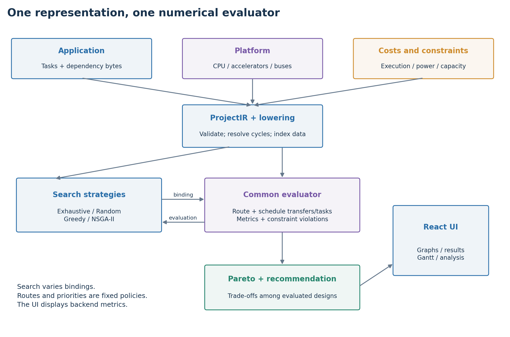

## Backend reading guide

The following paths are relative to dse/backend. Read models first, then validation/lowering, scheduler/evaluator, search, and finally the API and persistence layers.

| Module | Responsibility |
| --- | --- |
| app/ir/models.py | Typed contracts for projects, candidates, schedules and metrics. |
| app/ir/validator.py | Checks identifiers, references, DAG acyclicity, timing and mapping coverage. |
| app/ir/lowering.py | Converts cycles to time, indexes objects, creates communication events and derives bus routes. |
| app/ir/presets.py | Lowers simple CPU/FPGA inputs into the common IR. |
| app/core/scheduler.py | Event-driven, non-preemptive list scheduling and independent precedence/slot checks. |
| app/core/evaluator.py | Common timing, energy, cost, area, memory and constraint calculations. |
| app/search/ | Candidate generation, four search strategies, Pareto extraction and recommendation. |
| app/analysis/bottlenecks.py | Critical-chain summaries, busy times and evaluated alternative task bindings. |
| app/api/ | Project lifecycle, manual evaluation, exploration, events, comparison and exports. |
| app/persistence/repository.py | JSON storage and three seeded presets. |
| app/reporting/report_builder.py | Markdown/CSV formatting; JSON report export is exposed by the API. |
| app/main.py | FastAPI app, routers, CORS and error handling. |

The scheduler and evaluator have no FastAPI dependency, which makes direct numerical tests possible. Pydantic provides schema/type checks, but architectural invariants still need explicit validation; schema-valid input can remain invalid for the domain.

## Frontend reading guide

React and TypeScript provide the interface; Vite builds it and Tailwind CSS supplies styling. Zustand stores application state, React Flow displays graphs, ELK arranges their layout, and Recharts plots candidates. Relative /api requests are proxied to the backend during development.

| Frontend area | Responsibility |
| --- | --- |
| src/App.tsx | Loads projects and selects the active screen. |
| src/store/index.ts | Project/run state, selected designs and asynchronous actions; receives server-sent events. |
| src/api/client.ts | Typed HTTP client. |
| components/graph/ | Application graph, architecture and resource mapping views. |
| components/results/ | Design table, Pareto scatter, Gantt schedule and bottleneck views. |
| components/forms/ | Constraints and search settings. |
| components/compare/ | Side-by-side comparison. |
| components/dashboard/ and shell/ | Summary, logs, navigation, project selection and run controls. |
| src/lib/elkLayout.ts | Automatic graph layout. |

There is no frontend test script in package.json and no supplied component or end-to-end test suite. A successful production build establishes compilation, not button behaviour, layout correctness or state-transition correctness in a browser.

## Search and trade-offs

| Strategy | What it actually does |
| --- | --- |
| Exhaustive | Enumerates legal binding combinations until its budget. A global result requires complete enumeration under the fixed policies. |
| Random | Samples distinct bindings with a seeded generator; retry limits can stop sampling early. |
| Greedy | Explores one-task rebinding neighbours with restarts. Its internal score currently uses raw weighted values. |
| NSGA-II | Non-dominated Sorting Genetic Algorithm II: evolutionary selection, crossover, mutation and diversity by crowding distance. Budget/generation handling has reproduced defects. |

A candidate Pareto-dominates another when it is no worse on all selected objectives and strictly better on at least one. The Pareto set therefore retains meaningful alternatives such as faster-but-costlier and slower-but-cheaper designs.

Recommendation applies a weighted sum after min-max normalization over the currently found Pareto candidates. Ties use latency, cost and design ID. A recommendation depends on objectives, weights, explored candidates and fixed policies; it is not an unconditional best design. The greedy search's internal score is separate and does not perform this normalization.

When nothing is feasible, the backend retains designs with the fewest violations and warns that the recommendation is an infeasible fallback. Violation count does not measure violation magnitude: a small miss and a severe miss can have the same count.

# Numerical model and worked verification

## Timing, energy and units

For cycle-based timing, the lowering pass uses

$$t_{\mathrm{ms}}=\frac{N_{\mathrm{cycles}}}{1000f_{\mathrm{MHz}}}.$$

One transfer hop uses

$$t_{\mathrm{hop,ms}}=t_{\mathrm{setup,ms}}+\frac{D_{\mathrm{KB}}}{B_{\mathrm{MB/s}}}.$$

These are decimal KB and MB: 1 KB is 1,000 bytes and 1 MB is 1,000,000 bytes, not KiB or MiB. Thus 4 KB at 8 MB/s takes 0.5 ms; adding 0.25 ms setup gives 0.75 ms. Multi-hop communication is store-and-forward, with full setup and transfer cost on each hop. Intermediate buffer capacity and buffer energy are absent.

Latency is the latest event finish time, or makespan. Non-pipelined throughput is 1000 divided by latency in milliseconds. Calling it frames per second is meaningful when one graph execution is one frame. The pipelined mode instead estimates the initiation interval as the largest summed busy time of any resource; it does not construct a valid repeating schedule.

Energy adds active task energy, busy-bus energy and static resource energy:

$$E_{\mathrm{mJ}}=\frac{\sum_i P_{i,\mathrm{active,mW}}t_{i,\mathrm{ms}}+\sum_b P_{b,\mathrm{mW}}t_{b,\mathrm{busy,ms}}+L_{\mathrm{ms}}\sum_r P_{r,\mathrm{static,mW}}}{1000}.$$

Average power in watts is energy in millijoules divided by latency in milliseconds. Active power must be interpreted consistently as additional to separately supplied static power; otherwise inputs can double-count static consumption. Missing power stays unknown rather than becoming zero. Abstract ticks do not produce physical energy, power or throughput without a conversion to seconds.

Declared memory is the sum of task memory and edge data volumes. It stays constant across candidates and does not model buffer lifetimes, data reuse, placement, cache behaviour or memory bandwidth.

## Golden reference: 32 ticks

V1, V2 and V3 run on RISC; V4 runs on HWM1. V5 is local, while V6 and V7 use the bus. The verified priority sequence produces the following schedule.

| Object | Resource | Start (ticks) | Duration | Finish |
| --- | --- | --- | --- | --- |
| V1 | RISC | 0 | 1 | 1 |
| V2 | RISC | 1 | 20 | 21 |
| V5 | local | 1 | 0 | 1 |
| V3 | RISC | 21 | 8 | 29 |
| V6 | SB | 21 | 1 | 22 |
| V7 | SB | 29 | 1 | 30 |
| V4 | HWM1 | 30 | 2 | 32 |

V6 overlaps V3 because the transfer does not occupy RISC. V4 waits for both incoming transfers, giving 32 abstract ticks. There is only one legal binding, so this fixture verifies scheduling rather than optimisation search.

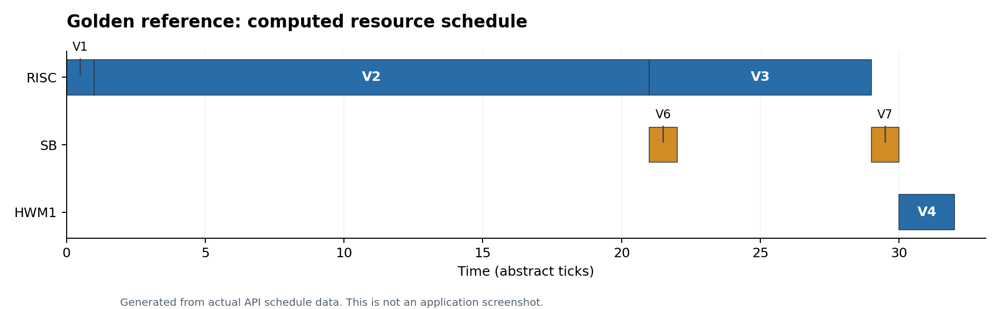

## Synthetic filtering walkthrough

Ingest and Aggregation each take 3 ms on the CPU. Filtering takes 4 ms on the CPU or 1 ms on ACC1. Both dependency edges carry 4 KB. A resource-crossing edge costs 0.75 ms on the specified bus.

All software takes 3 + 4 + 3 = 10 ms. Accelerated filtering takes 3 + 0.75 + 1 + 0.75 + 3 = 8.5 ms. Hardware saves 3 ms in computation but adds 1.5 ms of transfers. System speedup is 10/8.5 = 1.1765, even though Filtering itself is four times faster.

| Design | Latency (ms) | Cost | Energy (mJ) | Power (W) | Rate (/s) |
| --- | --- | --- | --- | --- | --- |
| All software | 10.0 | 10 | 18.700 | 1.870 | 100.00 |
| Filtering on ACC1 | 8.5 | 35 | 14.025 | 1.650 | 117.65 |

For all software, task energy is 13.2 mJ and static energy is 5.5 mJ, totalling 18.7 mJ. With ACC1, task energy is 7.5 mJ, busy-bus energy is 0.15 mJ and static energy is 6.375 mJ, totalling 14.025 mJ. The corresponding powers are 1.87 W and 1.65 W.

Both designs are Pareto-optimal for latency and cost. Equal normalized weights give equal scores; the lower-latency tie-break recommends ACC1. Latency improves by 15%, energy by 25%, and allocation cost increases by 3.5 times. These are analytical results from declared inputs, not hardware measurements.

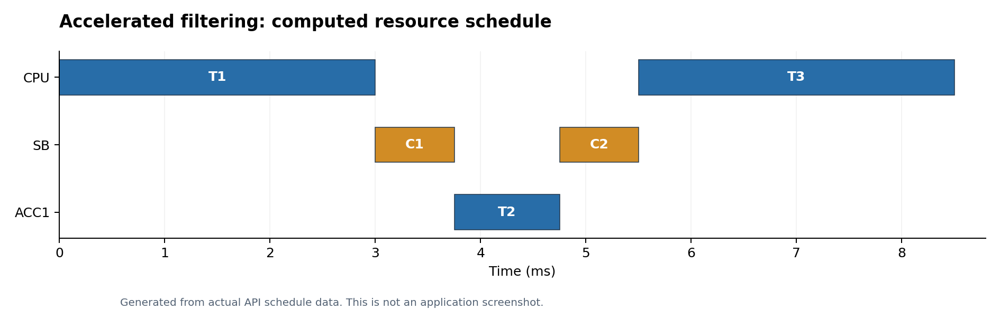

## CPU/FPGA preset: why more hardware can be slower

The CPU runs at 1,000 MHz and the field-programmable gate array, or FPGA, at 250 MHz. TaskA takes 3,000,000 software cycles or 1,000,000 hardware cycles: 3 ms and 4 ms respectively. Fewer cycles therefore do not make its FPGA option faster. TaskB takes 5 ms on the CPU or 3.2 ms in hardware; TaskC stays on the CPU at 2 ms.

| Partition | Latency (ms) | Cost | LUTs | DSPs |
| --- | --- | --- | --- | --- |
| B hardware; A/C software | 9.70 | 15 | 800 | 4 |
| All software | 10.00 | 10 | 0 | 0 |
| A and B in separate hardware modules | 10.70 | 20 | 1000 | 5 |
| A hardware; B/C software | 11.75 | 15 | 200 | 1 |

Hardware TaskB alone gives 3 + 0.75 + 3.2 + 0.75 + 2 = 9.7 ms. Hardware A and B gives 4 + 0.75 + 3.2 + 0.75 + 2 = 10.7 ms, including communication between separate accelerators. These outcomes illustrate end-to-end co-design reasoning.

This preset omits task active powers, so energy and average power are null. Independent testing also shows that the CPU/FPGA adapter ignores its FPGA static-power setting; filling active powers alone will not fix that omission.

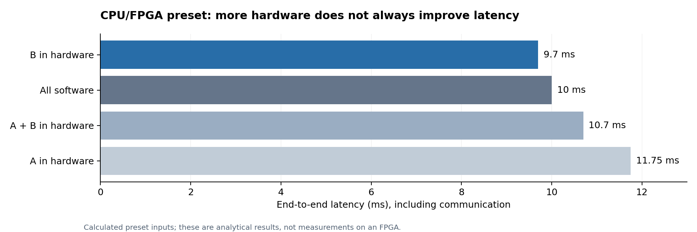

# Guided browser walkthrough

The following pages explain what to look at and why it matters. They use genuine cloud-browser captures of the reviewed application at a 1363 by 936 pixel viewport. The image links point to all 16 original viewport captures. Open a JPEG directly to zoom into the UI. Model diagrams are illustrations derived from source and verified numbers, rather than screenshots.

## Start with the whole system

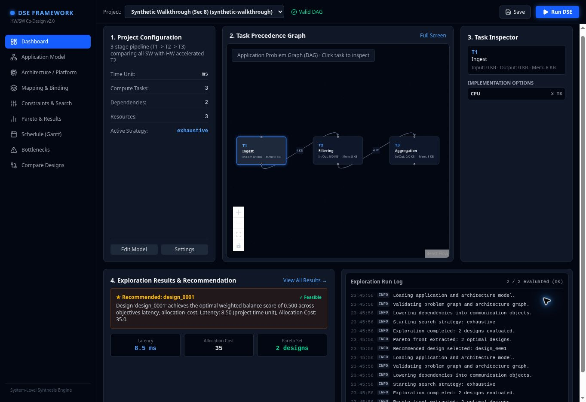

The project selector identifies the active model. The upper panels show the application graph and the selected task's legal implementation costs. The lower-left recommendation is the output of exploration, and the lower-right log records the run. These panels should all describe the same project and run.

| Read this area | Meaning in this capture |
| --- | --- |
| Application graph | Three stages, with Filtering between Ingest and Aggregation. |
| Recommendation | Filtering on ACC1; latency 8.5 ms; allocation cost 35. |
| Pareto set | Two non-dominated alternatives, not two feasible acceleration options that are equally cheap. |
| Run log | 2/2 evaluated. Repeated log messages are also visible, matching the earlier SSE duplication finding. |

The screenshot is an actual frontend result. The exact arithmetic still comes from the common backend evaluator, not from graph drawing in the browser.

## Separate application behaviour from platform resources

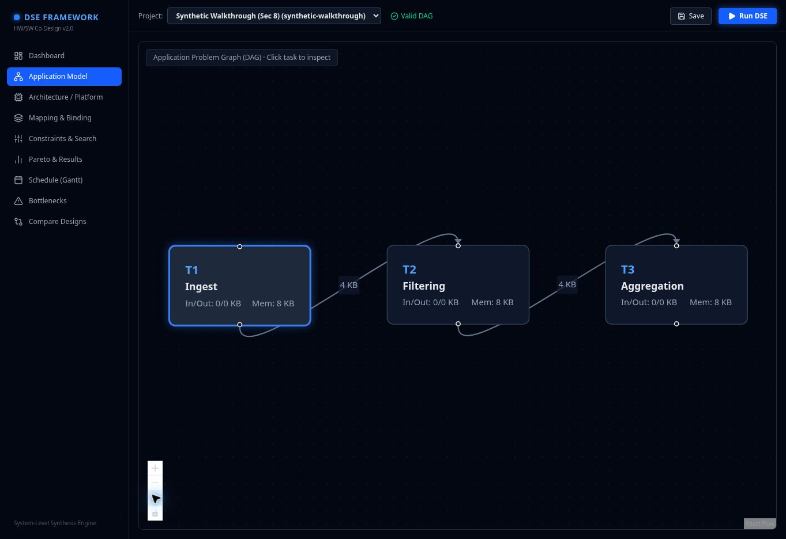

The graph specifies what must happen: T1 produces data for T2, and T2 produces data for T3. It does not itself specify that Filtering must run in hardware. The two 4 KB edge volumes become communication costs only if their endpoints bind to different resources.

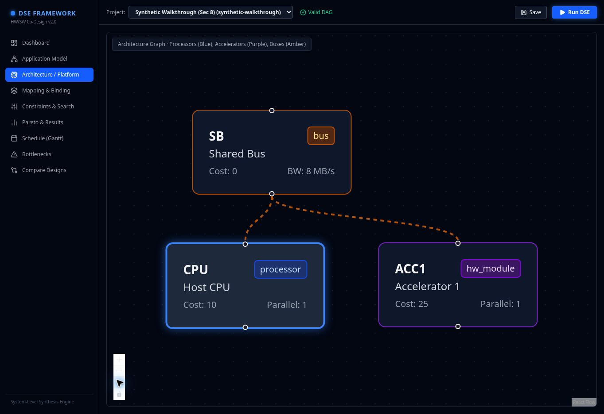

The platform specifies where work can run and how resources connect. CPU cost is 10; ACC1 cost is 25; each compute resource has one execution slot. The shared bus supplies 8 MB/s bandwidth. A task graph and an architecture graph describe different aspects of the system and should not be conflated.

## Binding determines which data crosses the bus

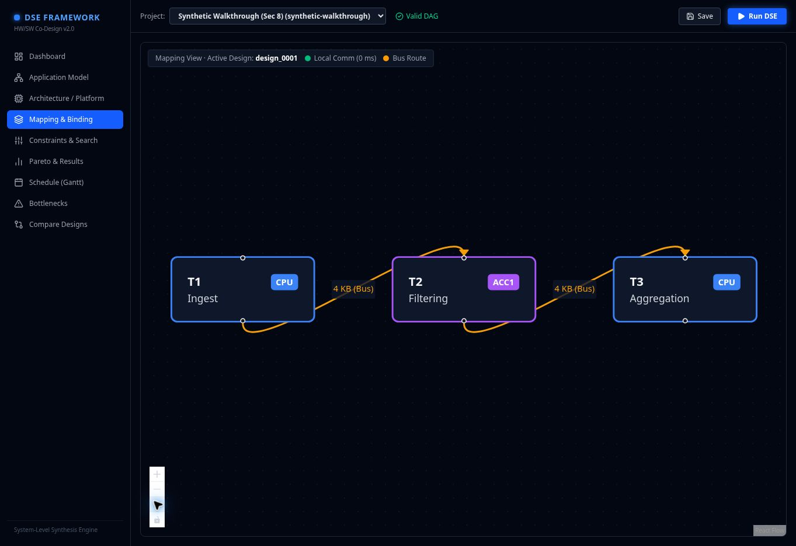

T1 and T3 stay on the CPU. T2 runs on ACC1. Both orange edges cross resource boundaries, so the schedule must include two transfers. Each transfer costs 0.25 ms setup plus 4 KB / 8 MB/s = 0.5 ms of data time: 0.75 ms per transfer.

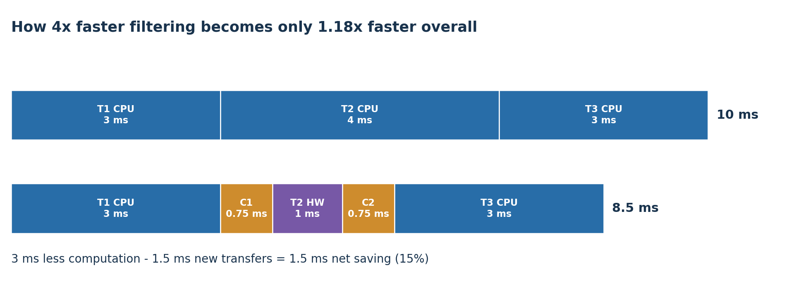

The fourfold speedup of T2 alone does not imply a fourfold system speedup. Computation falls from 10 to 7 ms, then 1.5 ms of transfer time is added. The final 8.5 ms gives a system speedup of 1.1765 and a 15% latency reduction. This is the central quantitative reason to evaluate complete partitions.

## Read the Pareto trade-off, not just the recommended star


The horizontal axis is latency; the vertical axis is allocation cost. The accelerated candidate is further left but higher: faster and more expensive. The software candidate is further right but lower: slower and cheaper. Neither dominates the other for these two objectives.

| Candidate | Binding of Filtering | Latency | Allocation cost | Energy |
| --- | --- | --- | --- | --- |
| design_0001 | ACC1 | 8.5 ms | 35 | 14.025 mJ |
| design_0002 | CPU | 10.0 ms | 10 | 18.700 mJ |

The star marks the weighted recommendation, not universal superiority. Equal normalized latency/cost weights tie these two candidates, after which the latency tie-break favours the accelerator. The right-hand table has a horizontal scrollbar at this viewport; clipped bindings are a layout consideration, not missing backend data.

## Connect mapping to actual execution time

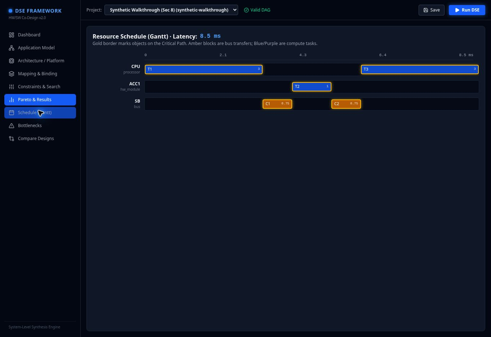

Read left to right: T1 runs from 0 to 3 ms; C1 transfers from 3 to 3.75; T2 executes from 3.75 to 4.75; C2 transfers from 4.75 to 5.5; T3 completes at 8.5. Amber blocks occupy the bus, while blue blocks occupy compute resources. The empty CPU interval does not mean the processor has vanished; the serial dependency chain is waiting on transfers and T2.

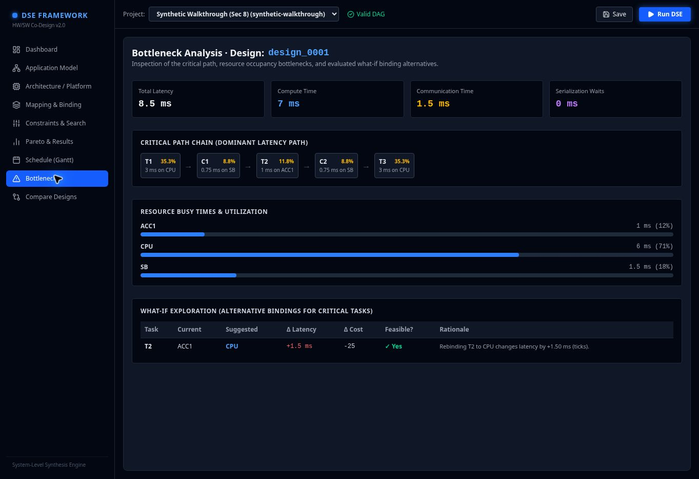

The displayed decomposition is consistent with the schedule. CPU busy time is 6 ms, ACC1 is 1 ms and the bus is 1.5 ms. Rebinding T2 to the CPU adds 1.5 ms of latency and saves 25 cost units. The serialization-wait field is derived from the reconstructed critical chain and must be interpreted with the limitations explained later.

## Compare metrics, then change the decision constraints

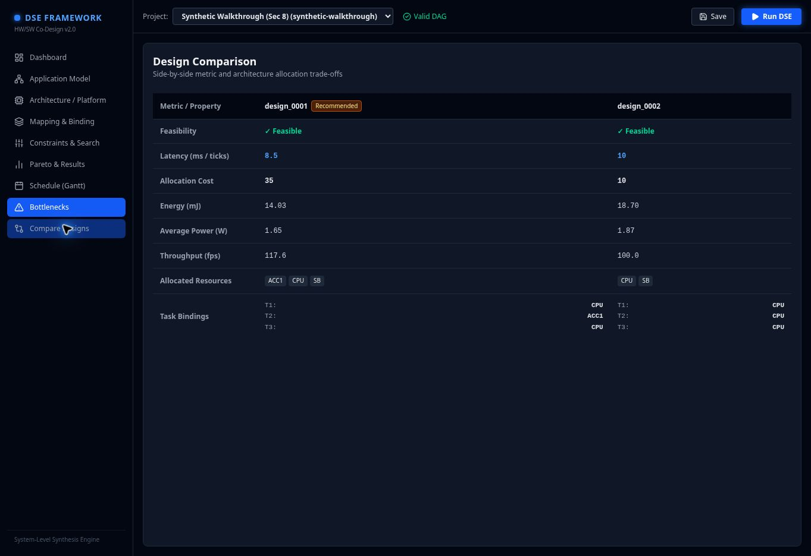

The default comparison renders matching latency, cost, energy, throughput and bindings for the two synthetic candidates. This verifies metric presentation. It does not prove that the screen respects arbitrary user-selected IDs; that separate test fails, as shown later.

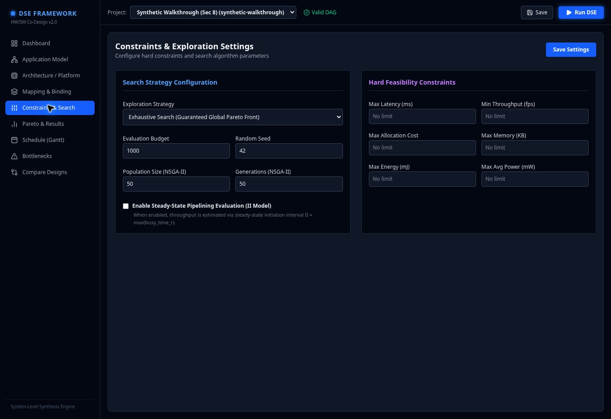

Hard constraints eliminate unacceptable candidates; objectives rank the remaining trade-offs. A maximum latency and a latency weight have different roles. The test saved a 0.1 ms latency limit, checked the resulting infeasible state, cleared that temporary limit, then verified a new feasible 8.5 ms run. NSGA-II generations and small-budget handling remain affected by the earlier backend findings despite their presence in this form.

## A failure state must be truthful everywhere

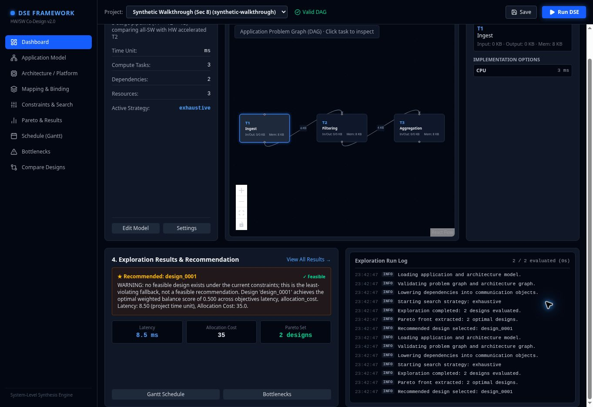

The warning states that no feasible design exists. In the same panel, the green badge says Feasible. This is a browser-reproduced presentation defect: a user can read a contradictory success signal even though the evaluator correctly rejects the deadline.

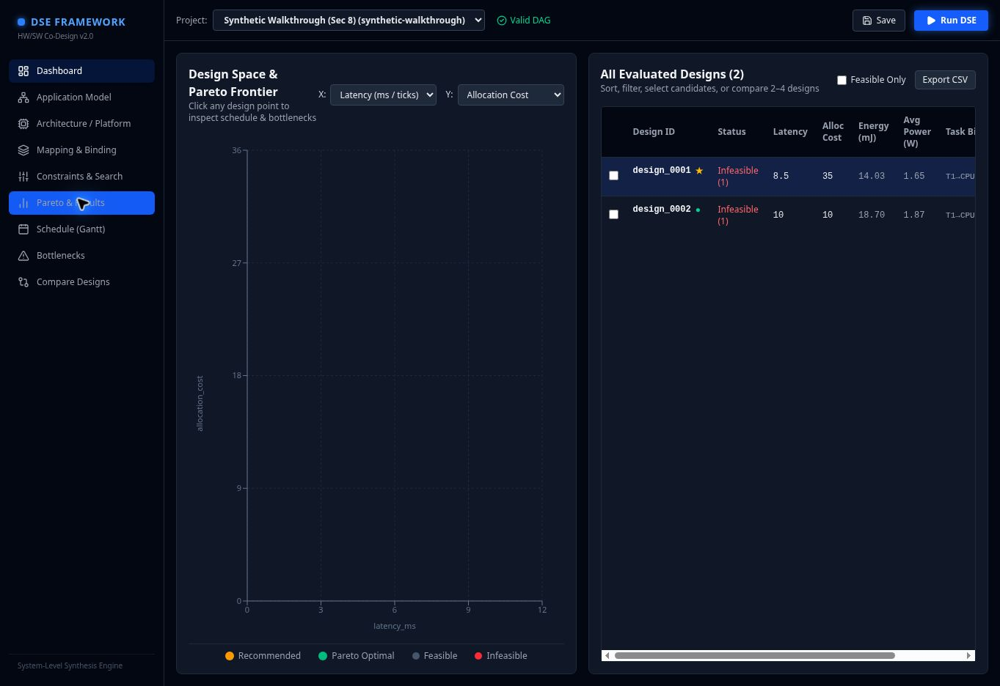

Both candidates have one violation. Checking Feasible Only reduced the displayed count from two to zero, as expected. The correct repair is to derive every feasibility label from the evaluation state and explicitly distinguish an infeasible fallback from a feasible recommendation. Changing only the warning text would leave the contradictory badge in place.

## Results must remain attached to their project

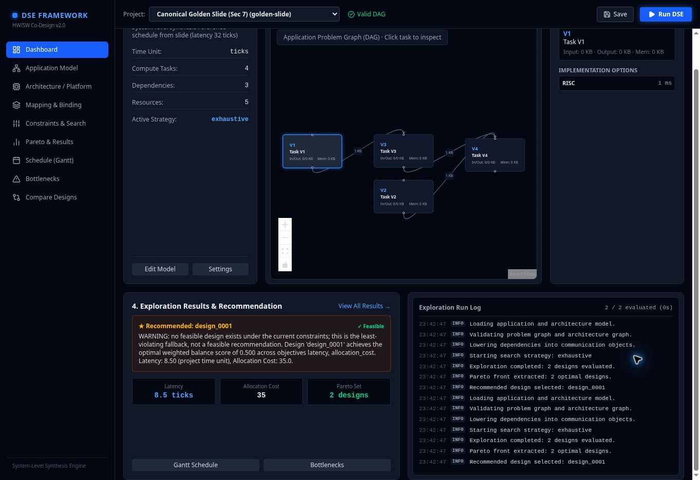

The selector and graph belong to the golden project, whose verified latency is 32 ticks. The recommendation still carries the previous project's 8.5 numerical value and cost 35, now labelled in ticks. The run log also belongs to the previous two-candidate exploration.

| Item | Expected after changing project | Observed before starting a new run |
| --- | --- | --- |
| Prior recommendation | Cleared, or retained only in its own project's history | Still visible in the new project. |
| Timing unit | Belongs to the result's original model | Old 8.5 ms is rendered as 8.5 ticks. |
| Selected design and bottlenecks | Scoped/reset with project identity | Previous run state remains populated. |

A fresh run updates the results, but that does not make the intermediate mixed state correct. The store should scope results by project/run identity and guard against late asynchronous callbacks.

## The same engine handles both reference and alternative models

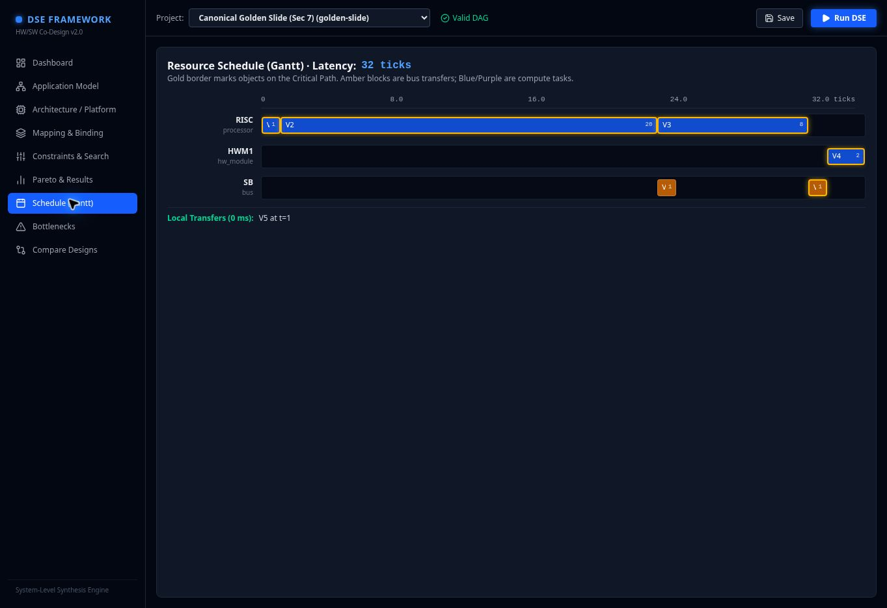

V6 occupies the bus from 21 to 22 while V3 runs on RISC from 21 to 29. V7 finishes at 30; V4 then runs from 30 to 32. The core schedule matches the reference. An auxiliary Local Transfers label still hard-codes ms in this ticks model, so its unit wording needs cleanup.

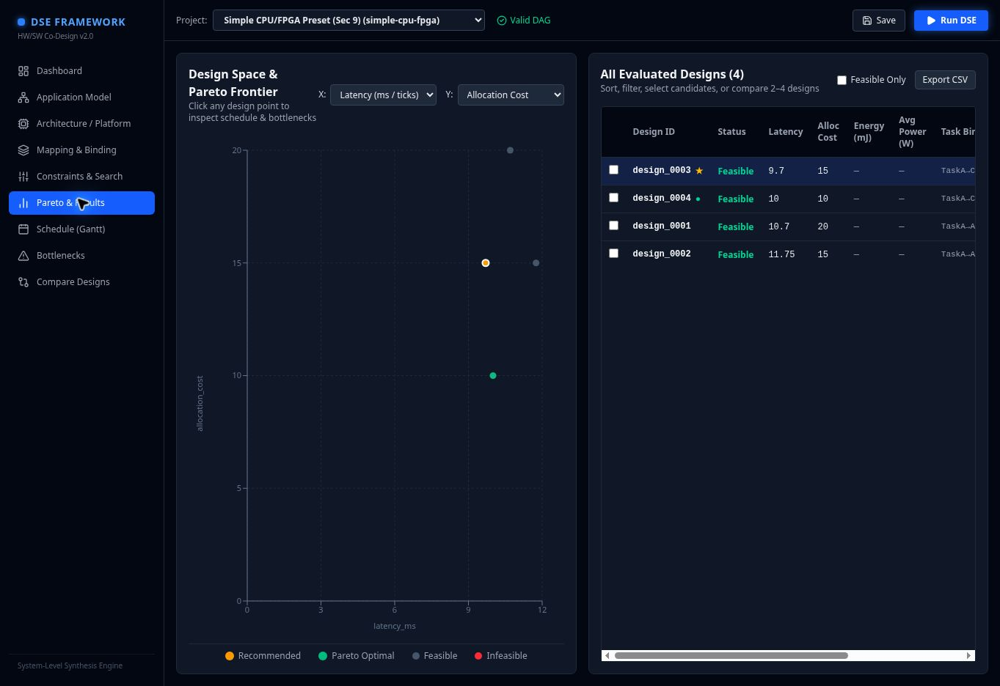

The four latencies are 9.7, 10, 10.7 and 11.75 ms. TaskB-only acceleration wins; accelerating TaskA is slower at the declared FPGA frequency. Missing power remains a dash in the table. A general framework must preserve the same model semantics when switching between these examples.

## A comparison must use the designs the user selected

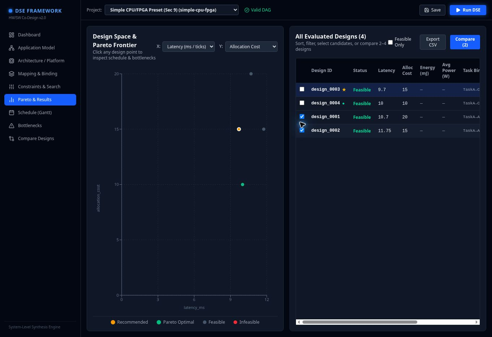

The selected rows are the 10.7 and 11.75 ms candidates. The expected next screen should compare those two designs, even though they are not Pareto-optimal.

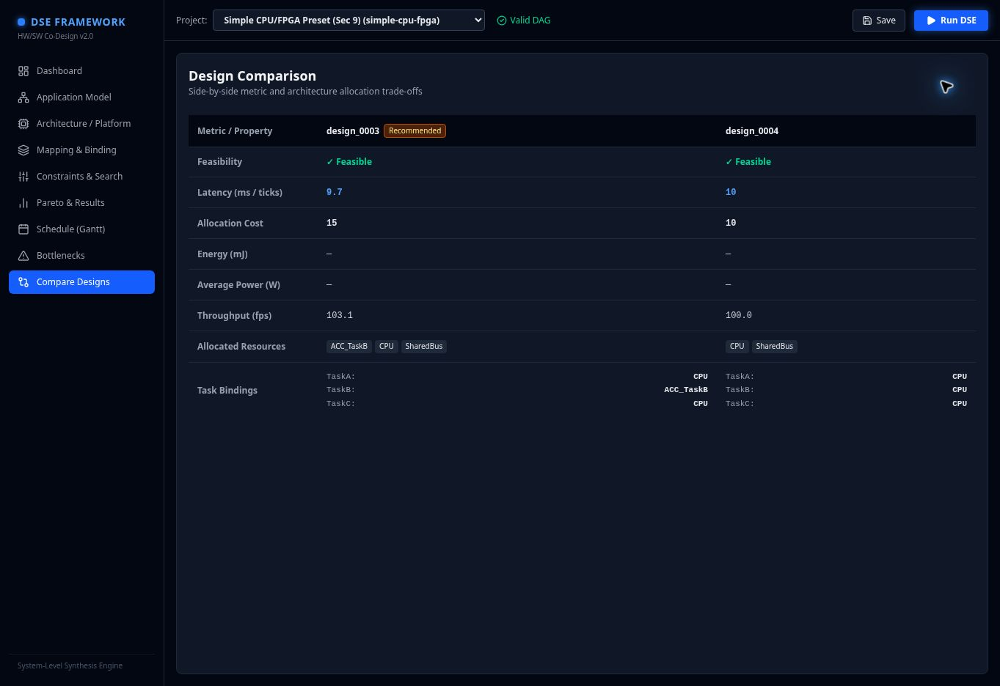

The view instead displays the 9.7 and 10 ms Pareto candidates. This reproduces the selection-wiring defect identified from source: checked IDs remain local to the results table, while the comparison view independently chooses Pareto designs. The existing ability to display a default comparison must not be reported as successful arbitrary-selection handling.

# Test methods and results

## Environment and boundaries

Tests ran on Linux with Python 3.12.14, Node.js 24.22.1 and npm 11.9.0. The isolated Python environment used FastAPI 0.162.0, Pydantic 2.14.2, Uvicorn 0.54.0, pytest 9.2.0, HTTPX 0.28.1 and pytest-cov 7.1.0. The full version list is preserved in raw/python_packages.txt. Broad declared dependency bounds mean this does not certify every package combination or Python 3.11.

Python packages needed for the exercised runtime/tests were installed directly; the complete numerical/plotting dependency set in pyproject.toml was not installed in that virtual environment. Those imports were not required by exercised paths. Editable-package installation and Docker Compose were not tested. Frontend dependencies came from the committed lockfile using npm ci --ignore-scripts.

A wildcard Vite launch failed because network-interface enumeration was unavailable in this environment. Launching with an explicit loopback host succeeded. The live-check script starts Uvicorn and Vite subprocesses in the same invocation and terminates them after testing. Those original HTTP checks verified HTML delivery and API proxying. The separate follow-up browser checks now execute the frontend and inspect its visible states through the supported private local preview. The QA launcher starts both services together and adds only the exact preview host to Vite through an environment variable.

Starlette TestClient emitted an HTTPX deprecation warning, and npm emitted an environment proxy warning. Neither caused the passing checks to fail. These are separate from application lint errors and correctness failures.

| Evidence set | Result | Meaning |
| --- | --- | --- |
| Supplied backend suite | 53 passed; 0 failed | Existing numerical/API tests. |
| Statement coverage | 89.02% | 1,679 of 1,886 statements. |
| Independent suite | 9 passed; 14 failed | 23 targeted domain checks. |
| Live HTTP/API checks | 28 passed; 1 failed | 29 checks; active cancellation failed. |
| Frontend build | PASS | Compilation and bundling; large-bundle warning. |
| Frontend lint | FAIL | 3 hook errors and 4 dependency warnings. |
| Browser follow-up | 14 passed; 3 failed; 1 unverified | 18 documented manual checks and 16 actual screenshots. |

## Supplied backend suite: every test

The suite ran unchanged with verbose pytest output, JUnit XML and statement coverage. Test names below are expanded into words for readability; exact names are preserved in XML/logs.

| Module | Test case | Result |
| --- | --- | --- |
| api.test_explore_api | exploration lifecycle and summary | PASS |
| api.test_projects_api | list projects includes seeded | PASS |
| api.test_projects_api | get project by id | PASS |
| api.test_projects_api | get unknown project 404 | PASS |
| api.test_projects_api | create and delete project | PASS |
| api.test_projects_api | validate project endpoint | PASS |
| api.test_projects_api | lowered ir endpoint | PASS |
| api.test_projects_api | evaluate candidate via api | PASS |
| api.test_projects_api | import and export | PASS |
| unit.test_checklist_regressions | walkthrough accelerated latency is 8 5 ms | PASS |
| unit.test_checklist_regressions | impossible latency marks all infeasible and flags recommendation | PASS |
| unit.test_checklist_regressions | simple preset area counted once | PASS |
| unit.test_evaluator | all software evaluation | PASS |
| unit.test_evaluator | accelerator mapping evaluation | PASS |
| unit.test_evaluator | pipelined throughput | PASS |
| unit.test_evaluator | null power handling | PASS |
| unit.test_evaluator | abstract time unit handling | PASS |
| unit.test_evaluator | hard constraint violation | PASS |
| unit.test_golden_scheduler | canonical golden schedule | PASS |
| unit.test_golden_scheduler | bus serialization contention | PASS |
| unit.test_health | health endpoint | PASS |
| unit.test_health | list projects endpoint | PASS |
| unit.test_ir_models | compute node instantiation | PASS |
| unit.test_ir_models | data edge aliases | PASS |
| unit.test_ir_models | resource instantiation | PASS |
| unit.test_ir_models | project ir roundtrip dict | PASS |
| unit.test_lowering | lower problem communication objects | PASS |
| unit.test_lowering | lower problem cycles conversion | PASS |
| unit.test_lowering | deterministic route local | PASS |
| unit.test_lowering | deterministic route single bus | PASS |
| unit.test_lowering | deterministic route unallocated bus | PASS |
| unit.test_lowering | multi hop route | PASS |
| unit.test_lowering | calculate hop transfer time | PASS |
| unit.test_pareto | pareto dominance | PASS |
| unit.test_pareto | pareto front extraction | PASS |
| unit.test_pareto | recommendation weighting | PASS |
| unit.test_presets | simple cpu fpga preset lowering | PASS |
| unit.test_search | candidate count and generation | PASS |
| unit.test_search | exhaustive search execution | PASS |
| unit.test_search | random search seeded reproducibility | PASS |
| unit.test_search | greedy search execution | PASS |
| unit.test_search | nsga2 search execution | PASS |
| unit.test_validator | valid project passes | PASS |
| unit.test_validator | duplicate node id | PASS |
| unit.test_validator | unknown node in edge | PASS |
| unit.test_validator | dag cycle detection | PASS |
| unit.test_validator | self loop detection | PASS |
| unit.test_validator | bus unknown endpoint | PASS |
| unit.test_validator | mapping node to bus rejected | PASS |
| unit.test_validator | missing execution time and cycles | PASS |
| unit.test_validator | cycles without clock rejected | PASS |
| unit.test_validator | unmapped node detected | PASS |
| unit.test_validator | multiple errors returned together | PASS |

Coverage records executed statements rather than semantic correctness. A line can execute and still apply the wrong formula. The fourteen independent failures below illustrate why 89% coverage is not a correctness certificate.

| File | Covered | Statements | Coverage |
| --- | --- | --- | --- |
| app/analysis/bottlenecks.py | 76 | 79 | 96.2% |
| app/api/explore.py | 187 | 257 | 72.8% |
| app/api/projects.py | 58 | 65 | 89.2% |
| app/core/evaluator.py | 128 | 135 | 94.8% |
| app/core/scheduler.py | 191 | 215 | 88.8% |
| app/ir/lowering.py | 105 | 111 | 94.6% |
| app/ir/models.py | 134 | 134 | 100.0% |
| app/ir/presets.py | 49 | 49 | 100.0% |
| app/ir/types.py | 25 | 25 | 100.0% |
| app/ir/validator.py | 130 | 157 | 82.8% |
| app/main.py | 19 | 25 | 76.0% |
| app/persistence/repository.py | 79 | 92 | 85.9% |
| app/reporting/report_builder.py | 43 | 43 | 100.0% |
| app/search/candidate.py | 63 | 69 | 91.3% |
| app/search/exhaustive.py | 17 | 17 | 100.0% |
| app/search/greedy.py | 90 | 96 | 93.8% |
| app/search/nsga2.py | 134 | 144 | 93.1% |
| app/search/pareto.py | 104 | 124 | 83.9% |
| app/search/random_search.py | 15 | 16 | 93.8% |
| app/search/runner.py | 32 | 33 | 97.0% |

## Independent checks: expected and observed

These separate tests assert intended domain behaviour, not the presence of known bugs. A failed assertion demonstrates that the tested code does not satisfy that expectation. The suite intentionally targets boundaries, so its failure rate is not an estimate of ordinary-user failure probability. Heuristic searches are tested for legal, reproducible output without incorrectly requiring recovery of the complete Pareto set.

| Check | Expected | Observed | Result |
| --- | --- | --- | --- |
| I01: decimal transfer units | 4 KB at 8 MB/s plus 0.25 ms setup is 0.75 ms. | 0.75 ms. | PASS |
| I02: execution cycles to ms | 200,000 cycles at 100 MHz is 2 ms. | 2 ms. | PASS |
| I03: per resource capacity is local | Two devices each using 60/100 logic remain feasible. | Both rejected using global usage 120. | FAIL |
| I04: global max area enforced | Total logic 120 exceeds global limit 100; reject. | Feasible, no violations. | FAIL |
| I05: fixed binding enforced by evaluator | A fixed to CPU cannot be bound to ACC. | Accepted on ACC. | FAIL |
| I06: mandatory allocation enforced | Explicit allocation includes mandatory CPU/bus. | ACC-only allocation accepted. | FAIL |
| I07: explicit route connectivity enforced | Disconnected explicit bus route is rejected. | Accepted; 4.75 ms schedule. | FAIL |
| I08: missing route rejected | Cross-resource edge without route is infeasible. | Infeasible as intended. | PASS |
| I09: communication ids disjoint from task ids | Communication ID cannot collide with compute ID A. | Validator accepts collision. | FAIL |
| I10: negative power rejected | Negative active power is invalid. | Validator reports valid. | FAIL |
| I11: unknown objective rejected | Unsupported objective must be rejected. | Validator reports valid. | FAIL |
| I12: unknown power stays null | Missing active power leaves energy unknown. | Energy null. | PASS |
| I13: abstract ticks disable physical metrics | No physical metrics without tick conversion. | Energy, power and throughput null. | PASS |
| I14: parallel resource schedule | Two independent 3 ms tasks in two CPU slots finish in 3 ms. | Latency 3 ms. | PASS |
| I15: multihop with explicit full allocation | Allocated bridge and buses yield correct two-hop timing. | Feasible, 5.5 ms. | PASS |
| I16: multihop canonical allocation includes bridge | Automatic allocation retains the transit bridge. | Bridge dropped; route becomes infeasible. | FAIL |
| I17: nsga2 hard evaluation budget | Budget 1 permits at most one distinct evaluation. | Two distinct candidates evaluated for population 4, seed 42. | FAIL |
| I18: nsga2 generations setting forwarded | Configured generations 3 reaches search. | 10 forwarded for budget 40/population 4; instrumented forwarding test. | FAIL |
| I19: project id cannot escape storage directory | ID cannot write outside project storage. | ../audit_escape writes an inert file outside temporary store. | FAIL |
| I20: synthetic benchmark exact values | Latency/energy/power equal hand calculations. | 10/18.7/1.87 and 8.5/14.025/1.65. | PASS |
| I21: all four searches return legal seeded results | All strategies give legal seeded reproducible output. | Passed; no global-recovery requirement for heuristics. | PASS |
| I22: persisted run retains design access | Saved designs accessible after in-memory entry is lost. | Design endpoint 200 before, 404 after simulated restart. | FAIL |
| I23: fpga static power affects energy | Changing FPGA static power changes accelerator energy. | 0 to 1000 mW leaves both energies 2.6 mJ. | FAIL |

## Live HTTP checks

These checks use real local HTTP servers. All three preset validations/explorations, bottleneck endpoints and nine exports succeeded. Comparison, pagination, expected errors, frontend delivery, API proxying and infeasible-fallback wording also succeeded. The completion replay SSE test is not a streaming-latency test during CPU-bound computation.

| Check | Result | Observation |
| --- | --- | --- |
| L01: health | PASS | {'status': 'ok', 'version': '0.1.0'} |
| L02: seeded projects | PASS | Required presets present. |
| L03: golden-slide validate | PASS | Valid; 0 errors. |
| L04: golden-slide explore | PASS | 1 designs; latencies [32.0]. |
| L05: golden-slide bottlenecks | PASS | HTTP 200; latency 32.0. |
| L06: golden-slide export md | PASS | HTTP 200; 2770 bytes. |
| L07: golden-slide export csv | PASS | HTTP 200; 188 bytes. |
| L08: golden-slide export json | PASS | HTTP 200; 4588 bytes. |
| L09: synthetic-walkthrough validate | PASS | Valid; 0 errors. |
| L10: synthetic-walkthrough explore | PASS | 2 designs; latencies [8.5, 10.0]. |
| L11: synthetic-walkthrough bottlenecks | PASS | HTTP 200; latency 8.5. |
| L12: synthetic-walkthrough export md | PASS | HTTP 200; 2960 bytes. |
| L13: synthetic-walkthrough export csv | PASS | HTTP 200; 318 bytes. |
| L14: synthetic-walkthrough export json | PASS | HTTP 200; 7128 bytes. |
| L15: simple-cpu-fpga validate | PASS | Valid; 0 errors. |
| L16: simple-cpu-fpga explore | PASS | 4 designs; latencies [9.7, 10.0, 10.7, 11.75]. |
| L17: simple-cpu-fpga bottlenecks | PASS | HTTP 200; latency 9.7. |
| L18: simple-cpu-fpga export md | PASS | HTTP 200; 3255 bytes. |
| L19: simple-cpu-fpga export csv | PASS | HTTP 200; 530 bytes. |
| L20: simple-cpu-fpga export json | PASS | HTTP 200; 11665 bytes. |
| L21: sse completed run replay | PASS | HTTP 200; 1 done and 14 log events. |
| L22: compare two | PASS | Two designs; four metric rows. |
| L23: pagination | PASS | 2 |
| L24: unknown project 404 | PASS | 404 |
| L25: unsupported export 422 | PASS | 422 |
| L26: frontend http | PASS | HTTP 200; 615 bytes. |
| L27: frontend api proxy | PASS | {'status': 'ok', 'version': '0.1.0'} |
| L28: impossible deadline fallback | PASS | Infeasible recommendation explicitly labelled as fallback. |
| L29: cancel interrupts active search | FAIL | Completed 3000; cancel delayed 1.8695 s. |

The cancellation probe used twelve independent tasks with two options each, giving 4,096 possible bindings, and budget 3,000. The start acknowledgement returned in 0.0035 s. An immediate cancel request took 1.8695 s; all 3,000 evaluations completed and final status was completed, although the response said cancelling. Timing is environment-specific; failure to interrupt is the substantive result.

The source directly explains this: an async background coroutine calls synchronous execute_search without yielding. The event loop cannot service requests and queued event tasks normally during CPU-bound work. A worker thread/process with safe cancellation signalling and event delivery is needed; an async wrapper alone does not make computation concurrent.

The short-run SSE response delivered fourteen log events for seven stored log entries: logs are replayed and queued copies are drained. Completion replay passed, but duplicate delivery should be repaired. No reconnection, multiple-subscriber or streaming-latency certification was performed.

# Findings and repair guidance

## Reproduced defects

Priority reflects the impact on generalized-model correctness and trustworthy operation. Each listed failure has a small reproduction in the audit tests or live-check script.

| Finding | Issue | Evidence | Repair |
| --- | --- | --- | --- |
| F1 / High | Global max-area ignored | I04: evaluator constraint checks omit max_area. | Check every global area dimension. |
| F2 / High | Per-device capacity uses system total | I03: each 60/100 resource compared with global 120. | Keep per-resource, group and global usage separately. |
| F3 / High | Manual candidate invariants bypassed | I05-I07: fixed binding, mandatory allocation and explicit-route connectivity are not enforced. | Validate every candidate before scheduling, including complete binding coverage. |
| F4 / High | Transit bridge omitted | I16: allocation retains route buses but not the required intermediate resource. | Allocate required transit resources or model bridges explicitly. |
| F5 / High | FPGA static-power ignored | I23: adapter config has no effect on allocated resource power. | Model fabric static power once whenever FPGA is allocated. |
| F6 / Medium | Compute and transfer ID collision | I09: both enter the same scheduler dictionary namespace. | Validate cross-namespace and generated-hop ID uniqueness. |
| F7 / Medium | Invalid model inputs accepted | I10-I11: negative power and unknown objective pass validation. | Validate finite non-negative values, objectives, weights and bounds. |
| F8 / Medium | NSGA-II exceeds small budget | I17: population initialization evaluates two unique designs with budget 1. | Enforce count before each new evaluation. |
| F9 / Medium | Generation setting ignored | I18: configured 3 becomes 10 in runner. | Define and enforce budget/generations policy; show effective settings. |
| F10 / High for untrusted input | Project ID escapes storage directory | I19: unchecked ID is concatenated into a filesystem path. | Restrict IDs and verify resolved path containment. |
| F11 / Medium | Persisted run inspection inconsistent | I22: summary/export can use disk, designs endpoint uses memory only. | Rehydrate one persisted run contract for all inspection endpoints. |
| F12 / High for run control | Search blocks cancellation/events | L29: synchronous search runs in request event loop. | Use an explicit job worker and cancellation/event channel. |

The first repair should establish one candidate-validation boundary shared by generated and manually supplied candidates. It must validate legal resources, complete task coverage, fixed bindings, mandatory allocation and route connectivity. Scheduler occupancy checks are not a replacement for those domain rules.

Resource usage must distinguish a device's own capacity, a shared group's capacity and a system-wide area limit. Using a global sum for each device rejects legal systems, while omitting the global constraint accepts illegal systems.

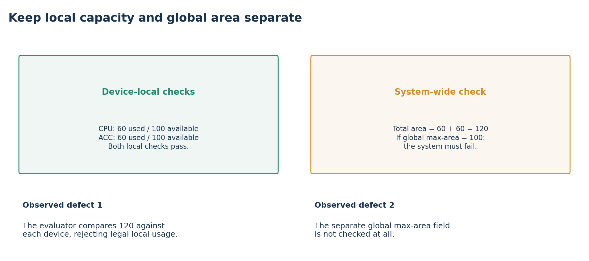

The path-containment test used only an inert file in a pytest-owned temporary directory. No private or unrelated file was read or overwritten. Actual impact depends on deployment permissions, but this is a concrete input-containment defect to fix before accepting untrusted JSON.

## Frontend findings: browser-confirmed and source-based

The false feasibility badge, stale project results and incorrect comparison selection are now reproduced in the cloud browser, with screenshots below. Conditional hooks are lint-confirmed. Settings resynchronization, the 200-result limit, unknown scatter values and CSV quoting remain source-based findings unless specifically covered by a browser check.

| Finding | Source evidence | Consequence / repair |
| --- | --- | --- |
| Conditional hooks | ConstraintsSettingsView returns before three useState calls. | Three lint errors. Use unconditional hooks or mount a separate loaded-project component. |
| False feasibility badge | Dashboard renders Feasible without checking recEval.feasible. | Can contradict backend infeasible-fallback warning; render status conditionally. |
| Cross-project stale results | selectProject changes project but leaves run summary, designs, active run and bottlenecks. | Scope/reset results; guard callbacks from prior runs. |
| Settings stale after switching | Local useState settings are initialized once from currentProject. | Resynchronize local form state on project identity change. |
| Comparison ignores checkbox choices | Table holds chosen IDs locally; Compare view uses first three Pareto designs. | Persist and pass the actual selected design IDs. |
| Only first 200 results loaded | Client requests page_size=200 once and stores items as allDesigns. | Implement pagination or progressive loading. |
| Unknown metrics become chart zero | Pareto scatter uses value ?? 0. | Omit/mark unknown values instead of inventing zero energy/power. |
| Browser CSV fields not fully quoted | Bindings JSON quotes doubled, but comma-containing field not wrapped in quotes. | Use a CSV serializer; backend CSV export passed separately. |
| Model editing is limited | Graph views wire selection/layout, not a full task/platform editor. | Describe as inspectors unless editing is implemented; backend JSON import exists. |

## Other limitations and source findings

The declared EXHAUSTIVE_CEILING constant is not enforced in the loop; the effective limit uses budget and space size. The UI's guaranteed-global-Pareto wording is valid only when the entire admissible binding space is evaluated under the fixed policies. The greedy module describes normalized scoring but its internal score sums raw weighted metric values; a change in units can alter its search trajectory.

The bus abstraction includes setup, data/bandwidth and non-preemptive occupancy. It does not implement APB/AHB/AXI signal-level handshakes, arbitration waveforms, bursts, cache coherency, clock crossing or memory-system contention. Supplied timings must incorporate any such effects claimed for a case study.

Pipelined throughput is an estimate, not a constructed periodic schedule. Its resource-work bound ignores max_parallel; this can misestimate parallel-capacity cases, while dependencies and buffer constraints can also prevent ideal overlap. Utilization is aggregate busy-time divided by makespan and can exceed one with multiple slots. Either label it as aggregate occupancy or normalize by slot capacity before presenting conventional utilization percentages.

Memory is a constant declared footprint, not a live-buffer or bandwidth analysis. Area usage is added per mapped task, so physical sharing/reuse needs an explicit accounting convention. Multi-hop intermediate buffer capacity is absent. Routes and priorities are fixed rather than searched.

The serialization-wait field is makespan minus the duration sum of the reconstructed critical chain. It does not independently measure time lost solely to bus arbitration. Critical-chain reconstruction also uses exact timestamp equality, which is fragile for floating-point times. These are scope or interpretation limits to state clearly, not evidence of measured hardware performance.

# Fit to the course-project brief

The uploaded brief asks: "Develop a framework for design space exploration to achieve hardware software co-design (in a generalized framework)? After the framework has been developed, showcase its utility by taking any particular application as case-study."

| Requirement | Assessment | Reason |
| --- | --- | --- |
| Generalized representation | Present | Typed tasks, heterogeneous resources, mappings and constraints share one evaluator. |
| Mapping/allocation/scheduling | Present, restricted | Bindings searched; allocation/routes/schedules follow fixed policies. |
| System overhead | Partly present | Bus transfer/setup/contention modelled; memory and buffers simplified. |
| Multi-objective exploration | Present, repairs needed | Four algorithms, Pareto analysis and recommendation exist. |
| Particular application case study | Incomplete evidence | Presets are synthetic; no calibrated, named application implementation found. |
| Verification | Incomplete, with browser evidence added | Boundary tests and three browser behaviour checks fail. |

The strongest element is the shared representation/evaluator connecting mapping, communication, scheduling and trade-offs. This matches the B.Tech syllabus topics of model representation, partitioning, mapping, scheduling, allocation and hardware-software communication. Syllabus alignment supplies context, not proof of the professor's marking criteria.

The major presentation gap is a particular application with defensible input costs. The filtering chain is a useful synthetic example, but does not identify a concrete filter implementation, workload size, dataset, timing source or target hardware. The golden schedule is a regression fixture and the CPU/FPGA preset is another synthetic example. They do not by themselves establish an empirically calibrated case study.

A focused completion path is to add one named application, for example a fixed-size image-processing chain, while retaining the generalized engine. Specify functionality, exact input dimensions, task dependencies and edge bytes. State the processor/FPGA frequencies, execution-cost source, resource use, power assumptions and bus setup/bandwidth. Declare the frame deadline and any memory/bandwidth constraints before choosing a partition.

Compare software-only execution, complete exhaustive search on a manageable instance, and seeded Random, Greedy and NSGA-II with equal actual evaluation budgets. Report end-to-end latency, feasibility, transfer overhead, cost/area, search runtime and energy only when all power inputs exist. Repeat stochastic experiments over several seeds and compare with the exhaustive front without calling heuristic output globally optimal.

A bandwidth/deadline sensitivity sweep can show when acceleration is worth its transfer cost. The existing CPU/FPGA example already gives a useful lesson: TaskB hardware helps, while adding TaskA hardware hurts. Correct constraints and calibrated evidence are more valuable now than simply adding more search algorithms.

## Repair order and acceptance evidence

| Order | Work | Acceptance check |
| --- | --- | --- |
| 1 | Global/local capacities, candidate validation, FPGA static power. | Corresponding independent tests pass without weakening domain assertions. |
| 2 | Worker execution, progress and cancellation. | Cancel interrupts before budget exhaustion; progress delivered while work runs. |
| 3 | ID containment, event IDs, invalid inputs. | Malformed models rejected and storage root preserved. |
| 4 | NSGA-II settings and persistence. | Actual budget/generation policy enforced; restarted runs inspectable. |
| 5 | Frontend lint, state, comparison and unknown metrics. | Zero hook errors plus browser tests of project switch, infeasible cases and large result sets. |
| 6 | Calibrated application case study. | Reproducible functionality, workload, architecture, cost sources and comparisons. |
| 7 | Browser regression after repairs. | Previously failing badge, project switch and selection tests pass. |

Preserve failing checks as regression tests. After repairs, rerun the supplied suite, affected independent tests, lint/build and relevant live checks. Expand testing when changed semantics justify it.

# Browser verification scope and remaining limits

The follow-up used the supported local preview in the cloud browser with user approval. The browser ran the actual React application and connected to the actual FastAPI backend.

The browser checklist below records eighteen manual checks: fourteen pass, three fail and one remains unverified. This is a documented smoke/regression checklist, not a new automated unit-test suite. The two result types must remain separate.

| Check | Result | Visible observation |
| --- | --- | --- |
| B01: Load application and select preset | PASS | Synthetic Walkthrough loaded; Valid DAG displayed. |
| B02: Run synthetic exploration | PASS | Two evaluated candidates; recommended 8.5 ms, cost 35. |
| B03: Application dependencies | PASS | T1 -> T2 -> T3; both edges show 4 KB. |
| B04: Platform connectivity | PASS | SB connects CPU and ACC1; bus bandwidth 8 MB/s. |
| B05: Recommended binding | PASS | T1/T3 on CPU, T2 on ACC1; both edges routed on bus. |
| B06: Pareto candidates | PASS | 8.5 ms/cost 35 and 10 ms/cost 10 candidates appear. |
| B07: Synthetic Gantt timing | PASS | CPU T1 [0,3], C1 [3,3.75], T2 [3.75,4.75], C2 [4.75,5.5], T3 [5.5,8.5]. |
| B08: Bottleneck arithmetic | PASS | 7 ms compute, 1.5 ms communication; T2->CPU adds 1.5 ms and reduces cost by 25. |
| B09: Comparison metric rendering | PASS | Default two synthetic candidates display matching metrics and bindings; arbitrary selection handled separately in B17. |
| B10: Save and restore deadline | PASS | 0.1 ms deadline saved, yielding infeasible results. Cleared afterward; a new run returned a feasible 8.5 ms recommendation. |
| B11: Impossible deadline in results table | PASS | Both candidates show Infeasible (1). |
| B12: Feasible-only filter | PASS | Checked filter with impossible deadline changes All Evaluated Designs (2) to (0); unchecked afterward. |
| B13: Dashboard feasibility truthfulness | FAIL | Green Feasible badge contradicts WARNING: no feasible design exists in the same recommendation panel. |
| B14: Project switch clears previous results | FAIL | Golden project selected while previous synthetic recommendation remains, relabelled as 8.5 ticks. |
| B15: Golden core schedule timing | PASS | 32 ticks; V6 overlaps V3; V4 [30,32]. Auxiliary local-transfer label still hard-codes ms. |
| B16: CPU/FPGA candidate metrics | PASS | Four candidates at 9.7, 10, 10.7 and 11.75 ms. |
| B17: Comparison follows selected IDs | FAIL | Selected design_0001 and design_0002; Compare (2) opens design_0003 and design_0004 instead. |
| B18: Browser CSV download content | UNVERIFIED | Export CSV clicked; supported download-event wait timed out and reset the browser automation runtime. No verified download path or content; no application failure inferred. |

The application's temporary synthetic deadline was restored and a feasible rerun verified. Sixteen full viewport JPEGs accompany the report, including screenshots of the three reproduced UI failures. In the bounded console query, no application-origin warning/error entries were returned. Browser-extension metadata errors appeared in the broader log and were not attributed to this codebase.

The CSV export click was attempted, but the supported download-event wait timed out and reset the automation runtime. No returned download path or downloaded content was verified. The CSV quoting concern therefore remains source-based, and this timeout is not counted as an application failure.

Responsive layouts at other viewport sizes, cross-browser behaviour, settings-state resynchronization while a form remains mounted, the 200-result UI limit, live cancellation in the browser, multiple-worker execution, Docker and physical hardware were not newly verified. The earlier live HTTP cancellation failure remains valid evidence. This follow-up adds UI observations rather than erasing the previous numerical failures.

# Reproduction and evidence

Use an isolated test directory because the checks create disposable project and run data. From the backend directory, with the required runtime/test dependencies installed, reproduce the supplied suite with:

```bash
python -m pytest tests/ -v --junitxml=existing_tests.xml \
  --cov=app --cov-report=term-missing --cov-report=json:coverage.json
```

Run the extracted independent suite with the backend on the import path:

```bash
PYTHONPATH=/path/to/project/dse/backend \
python -m pytest /path/to/evidence/test_independent.py -v
```

Fourteen failures are expected for the tested code until repaired. Exact test identifiers and assertion messages are in the XML and log. live_checks.py expects a sibling repo/dse tree and .venv beneath its parent directory, matching this workspace; adjust those paths for another checkout. It starts local subprocesses, creates audit-only project copies, checks HTTP endpoints and runs the 3,000-evaluation cancellation probe.

From the frontend directory, run:

```bash
npm ci --ignore-scripts
npm run lint
npm run build
```

## Evidence files

| File | Contents |
| --- | --- |
| [Browser checks](raw/browser_checks.json) | 18 manual checks with screenshot filenames under `images/screenshots/`. |
| [Independent tests](test_independent.py) and [JUnit results](raw/independent_tests.xml) | 23 targeted checks with assertion details. |
| [Supplied test results](raw/existing_tests.xml) and [coverage](raw/coverage.json) | 53 backend checks and statement coverage. |
| [Live checks](live_checks.py) and [observed results](raw/live_checks.json) | 29 HTTP checks, including the cancellation probe. |
| [Benchmark data](raw/benchmarks.json) | Preset metrics and schedules. |
| [Frontend lint](raw/frontend_lint.log) and [build](raw/frontend_build.log) | Recorded diagnostics. |

# Source references

Paths are relative to the project directory. Line numbers refer to the tested code.

| Topic | File and line |
| --- | --- |
| Global/local capacity checks | `dse/backend/app/core/evaluator.py:202` |
| Candidate schedule checks | `dse/backend/app/core/scheduler.py:40` |
| Canonical allocation | `dse/backend/app/core/evaluator.py:31` |
| Domain validation | `dse/backend/app/ir/validator.py:37` |
| FPGA adapter | `dse/backend/app/ir/presets.py:97` |
| NSGA-II settings | `dse/backend/app/search/runner.py:71` |
| Storage path | `dse/backend/app/persistence/repository.py:78` |
| Blocking search call | `dse/backend/app/api/explore.py:132` |
| Persisted-run contracts | `dse/backend/app/api/explore.py:234` |
| Dashboard feasibility badge | `dse/frontend/src/components/dashboard/DashboardView.tsx:140` |
| Project switch state | `dse/frontend/src/store/index.ts:99` |
| Conditional hooks | `dse/frontend/src/components/forms/ConstraintsSettingsView.tsx:13` |
| Compare selection | `dse/frontend/src/components/compare/CompareDesignsView.tsx:15` |

